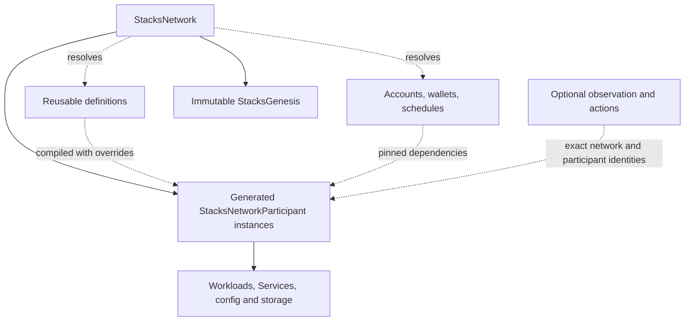

# Network API

This directory is the reference for the served stacks-k8s Kubernetes APIs: resource
relationships, ownership, lifecycle and protocol boundaries. The generated CRDs in
each chart define served schema validation; the generated field references below list
every field. The [network runtime](../network-operator/runtime.md) describes the
controllers and workloads that implement the network API.

## Documents

| Document | Purpose |
| --- | --- |
| [Composition](composition.md) | Heterogeneous participants, reusable refs, inline definitions, overrides and identity. |
| [Resources](resources.md) | Per-kind semantics, update rules, controls, outcomes and reasons. |
| [Lifecycle](lifecycle.md) | Resolution, genesis freeze, updates, phases, destructive removal and disposal. |
| [Protocol timing](protocol-timing.md) | Source-derived initialization gates and readiness evidence. |
| [Implementation notes](implementation-notes.md) | Status field managers, generated-name formulas and Chaos Mesh selection. |
| [Thirty-actor walkthrough](walkthrough.md) | Startup, late participation, live changes and fresh repetition. |
| [Baseline](examples/30-actors.yaml), [minimal cohort](examples/minimal.yaml), [separate roles](examples/separate-roles.yaml), [late participants](examples/late-participant.yaml), [optional resources](examples/optional.yaml) | Example inputs. |

## Served kinds

All kinds are namespaced. Each operator chart installs its own CRDs:
[network](../../charts/stacks-network-operator/crds/),
[action](../../charts/stacks-action-operator/crds/) and
[observability](../../charts/stacks-observability-operator/crds/).

| Kind | API version | Created by | Purpose | Fields |
| --- | --- | --- | --- | --- |
| `StacksNetwork` | `network.stacks.org/v1alpha2` | User | Root: selects participants, freezes genesis, requests operation. | [reference](../../.agents/skills/stacks-k8s-topology/references/stacksnetwork.md) |
| `StacksNetworkParticipant` | `network.stacks.org/v1alpha2` | Network operator | Generated instance: admitted policy, runtime and execution status. | [reference](../../.agents/skills/stacks-k8s-topology/references/stacksnetworkparticipant.md) |
| `StacksGenesis` | `network.stacks.org/v1alpha2` | Network operator | Immutable chain inputs and captured bootstrap requirements. | [reference](../../.agents/skills/stacks-k8s-topology/references/stacksgenesis.md) |
| `StacksEpochSchedule` | `network.stacks.org/v1alpha2` | User | Reusable immutable epoch activation heights. | [reference](../../.agents/skills/stacks-k8s-topology/references/stacksepochschedule.md) |
| `BitcoinNode` | `bitcoin.stacks.org/v1alpha2` | User | Reusable Bitcoin Core actor definition. | [reference](../../.agents/skills/stacks-k8s-topology/references/bitcoinnode.md) |
| `BitcoinWallet` | `bitcoin.stacks.org/v1alpha2` | User | Reusable watch-only wallet identity. | [reference](../../.agents/skills/stacks-k8s-topology/references/bitcoinwallet.md) |
| `BitcoinBlockSchedule` | `bitcoin.stacks.org/v1alpha2` | User | Reusable immutable block cadence. | [reference](../../.agents/skills/stacks-k8s-topology/references/bitcoinblockschedule.md) |
| `BitcoinBlockProduction` | `bitcoin.stacks.org/v1alpha2` | User | Baseline block production and bootstrap funding definition. | [reference](../../.agents/skills/stacks-k8s-topology/references/bitcoinblockproduction.md) |
| `BitcoinBlockScheduleOverride` | `bitcoin.stacks.org/v1alpha2` | User | Temporary timing override that resumes the latest baseline. | [reference](../../.agents/skills/stacks-k8s-topology/references/bitcoinblockscheduleoverride.md) |
| `BitcoinExecution` | `bitcoin.stacks.org/v1alpha2` | Network operator | Per-target Bitcoin RPC execution and accounting record. | [reference](../../.agents/skills/stacks-k8s-topology/references/bitcoinexecution.md) |
| `BitcoinInitialization` | `bitcoin.stacks.org/v1alpha2` | Network operator | Retained bootstrap funding and scheduler record. | [reference](../../.agents/skills/stacks-k8s-topology/references/bitcoininitialization.md) |
| `StacksAccount` | `stacks.stacks.org/v1alpha2` | User | Reusable Stacks key or public identity. | [reference](../../.agents/skills/stacks-k8s-topology/references/stacksaccount.md) |
| `StacksNode` | `stacks.stacks.org/v1alpha2` | User | Reusable Stacks node (miner or follower) definition. | [reference](../../.agents/skills/stacks-k8s-topology/references/stacksnode.md) |
| `StacksSigner` | `stacks.stacks.org/v1alpha2` | User | Reusable consensus signer definition. | [reference](../../.agents/skills/stacks-k8s-topology/references/stackssigner.md) |
| `StacksStacker` | `stacks.stacks.org/v1alpha2` | User | Reusable PoX-4/PoX-5 stacking policy. | [reference](../../.agents/skills/stacks-k8s-topology/references/stacksstacker.md) |
| `StacksContractSet` | `stacks.stacks.org/v1alpha2` | User | Reusable sBTC contract deployment and registry initialization. | [reference](../../.agents/skills/stacks-k8s-topology/references/stackscontractset.md) |
| `StacksTransactionProduction` | `stacks.stacks.org/v1alpha2` | User | Reusable baseline STX transfer traffic. | [reference](../../.agents/skills/stacks-k8s-topology/references/stackstransactionproduction.md) |
| `StacksFaucet` | `stacks.stacks.org/v1alpha2` | User | Reusable faucet account and limits. | [reference](../../.agents/skills/stacks-k8s-topology/references/stacksfaucet.md) |
| `StacksFaucetRequest` | `stacks.stacks.org/v1alpha2` | User | One bounded transfer from a network's faucet. | [reference](../../.agents/skills/stacks-k8s-topology/references/stacksfaucetrequest.md) |
| `BitcoinBlockGeneration` | `actions.stacks.org/v1alpha2` | User | Bounded Bitcoin block generation action. | [reference](../../.agents/skills/stacks-k8s-faults/references/bitcoinblockgeneration.md) |
| `BitcoinReorganization` | `actions.stacks.org/v1alpha2` | User | Bounded Bitcoin reorganization action. | [reference](../../.agents/skills/stacks-k8s-faults/references/bitcoinreorganization.md) |
| `NetworkTelemetry` | `observation.stacks.org/v1alpha2` | User | Continuous read-only telemetry recording for one network. | [reference](../../.agents/skills/stacks-k8s-observability/references/networktelemetry.md) |
| `NetworkObservation` | `observation.stacks.org/v1alpha1` | User | One-shot read-only actor identity snapshot. | [reference](../../.agents/skills/stacks-k8s-observability/references/networkobservation.md) |

Action kinds are described in the [action operator](../action-operator/README.md) and
[Bitcoin actions](../action-operator/bitcoin-actions.md) docs; observation kinds in the
[observability guide](../observability/README.md). Native Chaos Mesh faults use upstream
CRDs; see [Chaos Mesh operations](../chaos/operations.md).

## Product contract

Install operators once, then declare networks. StacksNetwork resolves explicit
composition and maintains supported ongoing operation. Reusable definitions and
identity resources remain independent; generated participants own the network's
workloads. Ordinary regtest development, reliability/liveness/performance studies
and trusted defensive investigations are first-class uses. Actions, Chaos Mesh and
observability are optional. Operators are not scenario planners or forensic archives.

The `regtest-pox4-pox5-v1` profile supports direct PoX-4/PoX-5 maintenance and real
sBTC prerequisites with explicit test initialization. Delegated pools, real bridge
signers and PoX-1–3 participation are not supported. Shared keys and unusual actor
combinations are legal experiment inputs; deterministic runtime outcomes are not promised.

## Declare a network

```yaml
# Excerpt; the baseline supplies complete dependencies and genesis allocations.
apiVersion: network.stacks.org/v1alpha2
kind: StacksNetwork
metadata:
  name: network
  namespace: lab-30
spec:
  operation: Paused # Inspect before activation; default Running.
  profile: regtest-pox4-pox5-v1
  epochScheduleRef: {name: epochs}
  participants:
    - name: bitcoin-a
      kind: BitcoinNode
      definition:
        inline:
          bitcoinNode:
            peers: {discovery: Network}
    - name: miner-a
      kind: StacksNode
      definition: {ref: {name: standard-miner}}
      overrides:
        stacksNode:
          bitcoinNodeRef: {name: bitcoin-a}
          image: local/stacks:hypothesis-42
```

Participant names identify instances, not reusable definitions. The map-list supports
exactly one reference or typed inline definition per entry. Typed overrides affect
only that instance. Wiring names refer to selected participants; account, wallet and
schedule refs refer to independent CRs. Missing dependencies wait; none are implicitly
instantiated. Unselected definitions can remain parked.

Creating the root requests operation Running by default. operation Paused permits
resolution/inspection before activation; that network is Uninitialized, not Paused.
Running freezes an immutable StacksGenesis before starting protocol workloads.
The Initialized condition records completed bootstrap independently of later
Running, Paused, Stopped or Failed state. Genesis also retains the public requirements
of unfinished bootstrap gates; conflicting policy edits wait for those gates.
Root profile/epoch/genesis/defaults remain immutable; supported instance overrides
can change images/resources without editing defaults.
[Lifecycle](lifecycle.md#network-operation-and-observed-lifecycle) defines phase
precedence and transitions.

## Ownership and runtime controls



Solid edges are ownership; ordinary workload descendants keep their Kubernetes owner
chains. PVC retention is explicit. Definitions retain their own validation status;
instances expose effective policy, dependencies, workload references and observations.
The network reports lifecycle/genesis and bounded identity summaries, not every heartbeat.

The network aggregate alone owns participant admission and resolution/policy
projections; domain controllers own validation reports and workload/runtime facts;
scoped workers use native CR list/watch and write only execution status. Shared status
uses minimal server-side apply payloads with disjoint field/condition ownership (see
[implementation notes](implementation-notes.md#shared-status-apply-contract));
ConfigMaps hold configuration, not command queues.

Workload controls are kind-specific. Actors can suspend/restart with documented Pod
and storage effects; Stacks management workers can cooperatively pause while their
processes survive. No generic process supervisor is provided. A management worker
crash fails the network; operator restart/watch reconnection does not replace it.
Bitcoin execution uncertainty retains its separate durable contract.

**Participant removal is destructive.** Remove its entry to delete runtime according
to cleanup/storage rules; use a new participant name for a replacement. Deleting the
network disposes all its runtime, preserving reusable definitions and keys. There is
no retirement lifecycle, destruction CRD or evidence-export gate. The optional
observability operator can record configured telemetry; export any other needed
artifacts before destructive operations. Retained PVCs are not complete forensic evidence.

One canonical network per namespace prevents overlapping roots during finalization.
A new root UID gets fresh runtime/data; parallel experiments use separate namespaces.
There is no historical-run registry, automatic replay or credential-distribution controller.

## Common vocabulary and bounds

Requests pin the network UID and resolve a participant name to its UID. Definitions
may be used more than once; no runtime identity is derived solely from their UID.

Conditions carry observedGeneration, reason, message and transition time. Resolved
means inputs agree; Initialized means fixed protocol gates completed; Running describes
current operating state; [Operational](lifecycle.md#operational-condition) requires
fresh baseline progress and contract observations, not readiness of every participant.

Bounds: 100 participants per actor kind, 100 stackers, one of each singleton
maintenance kind, 1000 lifetime instance identities, 1000 accounts/allocations,
63-character DNS-label participant names, and fourteen quoted supported epochs with
nondecreasing uint32 heights (first two zero). Amounts obey supported uint64 supply
limits. Status contains summaries/refs, never keys, signed bytes or logs. The fixed
release observation policy, published in `status.observationPolicy` and described in
the [network runtime](../network-operator/runtime.md), defines polling, freshness,
heartbeat and progress windows; it is not a per-resource tuning surface. Coalesced
status heartbeats and CR watches do not promise a latency SLA.
