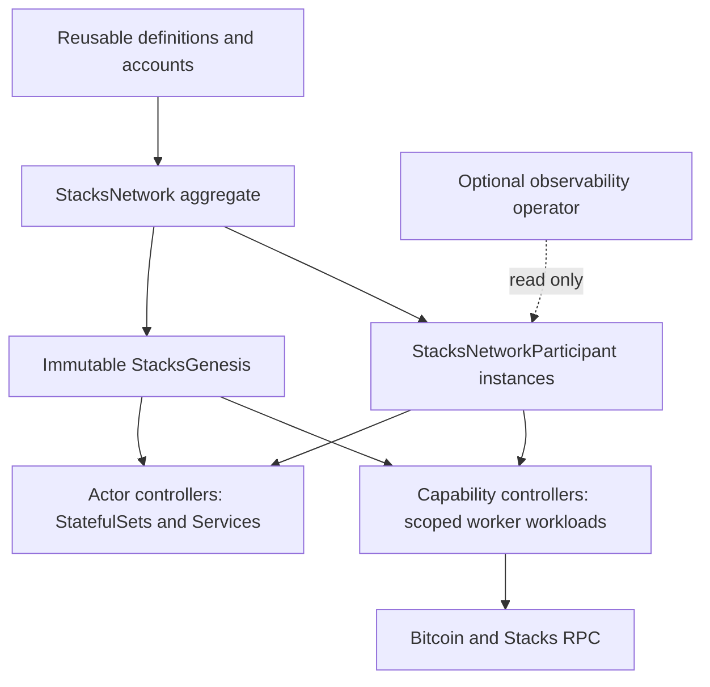

# Network operator runtime

The network operator implements the [network API](../api/README.md). Install the
[network chart](../../charts/stacks-network-operator/README.md) once per cluster; see
[operations](operations.md) and [installation compatibility](migration.md). One operator
watches every namespace through a ClusterRole. An individual network is a namespaced
`StacksNetwork`, not a Helm release.

## Image and entrypoints

One `stacks-network-operator` image (`operators/network/Dockerfile`) supplies every
network runtime process:

| Entrypoint | Runs as | Purpose |
| --- | --- | --- |
| `/foundation --mode=controller` | Operator Deployment (one replica, leader election) | All network controllers |
| `/foundation --mode=resolve-key` | Scoped Job | Generate or inspect one account or wallet key; publish its public identity |
| `/foundation --mode=resolve-bitcoin-config`, `resolve-stacks-config`, `validate-stacks-config` | Scoped Job | Render or validate actor configuration |
| `/foundation --mode=bitcoin-control` | One Deployment per `BitcoinNode` participant | Wallet and mutation RPC against that Core node |
| `/stacks-worker --role=<kind>` | One Pod per Stacks management participant | Stacker, contract-set, transaction-production or faucet protocol role |
| `/bitcoin-observer` | Optional Bitcoin actor sidecar | Read-only RPC observation; see [observer](bitcoin-observer.md) |

Jobs, workers and the control Deployment use the operator's own image. The observer
sidecar uses the separately pinned `bitcoinObserverImage` chart value, so changing the
operator image does not change the sidecar. Actors default to `bitcoin/bitcoin:31.1`,
`ghcr.io/stacks-network/stacks-core:4.0.5` and `ghcr.io/stacks-network/stacks-signer:4.0.5`.
The image embeds the hash-verified sBTC contracts from revision
`d31b0780cf1ae91b6ef4ed7ee89400c796aea913`; no sBTC signer daemon, Stacks API indexer or
source checkout is required.

The portable `libs/stacks` and `libs/bitcoin` modules supply RPC, Clarity, transaction
signing and PoX primitives without Kubernetes dependencies. Stacks.js is a
development-only test oracle; runtime images contain no JavaScript. The
[implementation notes](../api/implementation-notes.md) define module boundaries and
generated-name formulas.

A bound Stacks worker keeps the image recorded in its Pod; chart upgrades select the
new image for later workers only. Bitcoin control Deployments follow the operator image
and roll through their drain (see [Bitcoin production](bitcoin-production.md)).

## Controllers and status ownership

The aggregate (`StacksNetwork`) controller resolves dependencies, validates topology,
owns each participant's spec and complete admission, freezes `StacksGenesis` and
projects network lifecycle. Domain controllers provision workloads for their participant
kind and report runtime facts. Bound workers report execution. Separate controllers
resolve reusable accounts and wallets, validate reusable definitions, apply schedule
overrides, schedule Bitcoin production and admit faucet requests.

| Resource / fields | Writer |
| --- | --- |
| `StacksNetwork` status | Aggregate controller only |
| Participant `status.admission`; `Resolved`, `PolicyDeferred` and `AdmissionReady` conditions | Aggregate controller only; domain reports supply facts, never partial admission |
| Participant `status.runtime`, `status.bitcoinControl`; `ConfigVerified`, `WorkloadReady` and `PlacementReady` conditions | The participant's domain controller |
| Participant `status.scheduling` | Bitcoin production scheduler |
| Participant `status.execution` | The exact bound Stacks worker process |
| `BitcoinExecution` status | The scoped Bitcoin control worker (CAS updates) |
| `StacksFaucetRequest` `status.admission`, `phase`, conditions | Faucet request controller |
| `StacksFaucetRequest` `status.execution` | The bound faucet worker |

Shared status objects use server-side apply through the status subresource with fixed
field managers and minimal payloads; see the [status apply
contract](../api/implementation-notes.md). Conditions are map-lists keyed by type, and
no condition has concurrent writers. RBAC grants status access per object, not per
field, so field ownership is a trusted-writer contract. Status writes carry UID
preconditions and cannot create or adopt a replacement object. Policy and control
summaries on the root are projections of worker acknowledgements; the root reports
`Paused` only once current acknowledgements agree.

Runtime roots have their generated participant as controller owner; participants belong
to the network. Reusable identity children belong to their account, node or faucet.
Retained PVCs carry network labels but no cascading owner. User declarations request
production and actions; users do not create or edit generated participants or execution
records.

Watches route generation, UID, deletion and validation changes to admission through
dependency indexes. Execution heartbeats and observation-only updates do not enqueue the
whole graph; freshness expiry is timer-driven. Admission memoizes dependency identities
within one reconciliation; freeze uses a separate fresh pass. Gate transitions, failures,
lifecycle changes, Bitcoin target selection and dispatch authorization use uncached API
reads. Kubernetes Events are notifications, not commands.

## Composition and identities

A canonical `StacksNetwork/network` selects reusable definitions or inline participants.
Compilation applies network defaults, definition values and typed entry overrides, then
fills absent profile values. Lists replace inherited lists. Each generated participant
belongs to the network; independently owned definitions and accounts survive its deletion.
Participant names are single-use within a network. Removing an entry destroys that
instance; deleting an instance directly does not authorize its recreation.

Accounts resolve independently. Scoped resolver Jobs generate or inspect keys and publish
public identities. A replaced public report gets a new inspection Job bound to the same
immutable credential UID. Shared signing accounts are legal experiment inputs; the
operator does not lease their nonces. Required baseline signing roles need initial funds.
A faucet allocation of `"0"` permits later funding without contributing a genesis balance.

The aggregate is the sole participant-admission writer. Candidate errors block the
affected participants and dependent inputs, while unrelated admissions, controls and
removals continue. Existing signer attachments take precedence over new contenders.
Static schema and CEL validate shape, bounds and immutability; live cross-resource rules
(membership, UID and Secret identity, dependency and genesis agreement) are resolution
conditions evaluated before side effects. There is no admission webhook.

## Genesis and initialization

Successful creation of `StacksGenesis` freezes chain allocations, epoch/PoX settings,
contract sources and initial cohort requirements. The immutable artifact is bounded to
900 KiB. Its chain digest excludes provenance and bootstrap requirements; `inputDigest`
uses logical names, compiled configuration and public fingerprints without runtime UIDs.
Exact identities remain in provenance and admission bindings.

Initialization is continuously reconciled. Bitcoin production observes the frozen gates;
stackers enroll and renew, contract workers deploy and verify the pinned sBTC bundle, and
transaction production supplies demand. The [protocol timing contract](../api/protocol-timing.md)
defines gate evidence. Crossing a Bitcoin height or observing Pod readiness alone does
not satisfy a gate. The final release also requires fresh canonical traffic after the
waterfall boundary before `Initialized=True`.

Before the first Stacks block, `AwaitingFirstAnchor` records a fresh, empty native
chain view. A captured miner may request bounded Bitcoin confirmation progress
without claiming PoX readiness. Any captured node's established-chain observation
withdraws that allowance; legacy enrollment transactions then supply the demand.
Clarity-3 contract deployment additionally requires a native canonical Nakamoto
header, since Bitcoin can cross epoch 3.0 while the Stacks tip remains epoch 2.5.

Bootstrap requirements capture values needed after a controller restart, including initial
mining-enabled roles. Compatible image, resource and seed changes may proceed during
bootstrap. Conflicting supported policies retain the previous whole admission and report
`PolicyDeferred=True/BootstrapPending` until their last affected gate completes:

| Captured requirement | Last affected gate |
| --- | --- |
| Bitcoin wallet attachment and preparation | `PrepareBitcoin` |
| sBTC registry initialization | `PreparePoX5` |
| Stacker amount, coverage, renewal and initial mining role | `PrepareWaterfall` |

Protected identity changes report `RequiresReplacement` instead. Lifecycle controls remain
independent of either rejection. A retained policy must still have its exact current
public dependencies and credential UIDs. Missing dependencies withhold authorization;
retaining an admission for evidence does not authorize stale inputs. Publication recovery
uses the originally captured policy, never a newly edited cohort or a second genesis.

## Workloads

| Workload | Kind | Credentials |
| --- | --- | --- |
| Bitcoin node, Stacks node, consensus signer | Participant-owned StatefulSet, Services, PVCs and immutable configuration | Own configuration; signers receive their signing key and node event authentication material |
| Resolver | Short-lived Job | Only the inputs and outputs of one resolution |
| Bitcoin control | Participant-owned Deployment, `Recreate` strategy, 45-second grace | Its node's control RPC credential |
| Stacks management worker | Participant-owned Pod, `restartPolicy: Never`, 35-second grace | Only the keys its role declares (holder, administrator, deployer or sender) |

Actor configuration is resolved by scoped Jobs; Stacks configuration uses structured
TOML. Generated Stacks P2P and RPC advertisements use their allocated Service IPs; worker
and user endpoints retain Service DNS names. Both advertised Service UIDs are bound
into configuration resolution. Bitcoin configuration uses native scalar/repeated-option
overrides and one network section level, or a complete immutable `bitcoin.conf` Secret.
The resolver checks the captured UID, native syntax and required managed settings.
Bitcoin `ConfigVerified` attests that agreement, not Core option semantics or startup
compatibility. See [configuration](configuration.md) and the
[resource reference](../api/resources.md).

Consensus signers run separately from stacker administration. Event credentials survive
ordinary Pod rolls and are replaced only with their owning participant. Actor Pods keep
a read-only root filesystem with a writable `emptyDir` at `/tmp` for native scratch
files, discarded with the Pod.

### Services

| Endpoint | Clients |
| --- | --- |
| Bitcoin P2P 18444 | Bitcoin peers |
| Bitcoin RPC 18443 | Bound Stacks nodes (actor credential), the node's control worker (control credential), the optional observer |
| Stacks P2P 20444 | Stacks peers |
| Stacks RPC 20443 | Consensus signer and assigned Stacks workers |
| Signer events 30000 | The signer's configured Stacks node event observer |
| Stacks node metrics 9153, signer metrics 31000 | Optional Prometheus scraping |

Status publishes actual endpoints and workload references. Clients must not derive DNS
names or follow a definition name into a replacement network; names are UID-derived.

### Worker interface

Workers use client-go list/watch on their admitted custom resources and publish execution
through the status subresource. There is no command endpoint, broker or ConfigMap command
document. A notification queues reconciliation of current admitted state, never an
unconditional send. Watch reconnection is ordinary transport recovery.

The aggregate publishes complete participant admission: network, participant and Pod
UIDs, pinned dependencies and the full public policy. Activation requires the exact
durable Pod binding. Workers also require current root membership and the exact
participant UID; entry omission, instance deletion or root stop/delete withdraws new
activity even if admission status is stale.

### Permissions

The operator process reads Secret metadata only (metadata watches and clients; Secrets
bypass the cache), and never signing-key data. Its ClusterRole still grants Secret
`get/list/watch/create/patch`, so this is a code convention, not an RBAC limit. The
operator creates a ServiceAccount, Role and RoleBinding per worker and holds every
namespaced permission it delegates.

| Worker | Kubernetes access |
| --- | --- |
| Stacks worker | Named get/list/watch on the root, its own participant and profile inputs; patch on its own participant status; get on its own Pod. Faucets add namespace-scoped request watch and request status patch. No Secret, workload, exec or cluster-wide access. |
| Bitcoin control | Named get on the root, its participants, genesis, execution and initialization records, wallets, referenced definitions and node workloads; get on its RPC and configuration Secrets; update on its own `BitcoinExecution` status. Enabled action kinds add get/list. |

Bitcoin Core enforces separate `rpcauth` principals with `rpcwhitelistdefault=1`: the actor
principal has read and transaction-submission methods only; the control principal adds
wallet, generation, peer and `invalidateblock`/`reconsiderblock` methods. Actors and
optional action or observability controllers never receive the control credential.

## Execution and failure boundaries

Bitcoin control runs separately from peer and protocol traffic. It owns the mutation
credential and the durable `BitcoinExecution` record. RPC ambiguity closes the affected
target; controller deadlines do not prove that Core stopped executing a request. Pausing
blocks new managed sends while read-only observations and outstanding receipt collection
continue. See [Bitcoin production](bitcoin-production.md#execution-records).

Bitcoin generation and reorganization actions are separate installation opt-ins
(`bitcoinActions.*Enabled`), both disabled by default. They consume the same per-node
reservation and executor; the action operator never holds RPC credentials. Change these
flags only after reservations settle or the environment is disposed: disabling removes
read permission and can strand cleanup. See [Bitcoin actions](../action-operator/bitcoin-actions.md).

A surviving Stacks worker retains its nonce and pending submission in memory across watch
reconnects and operator restarts. Inclusion receipts are retained independently of
canonical rechecks. Traffic evidence is omitted until its first successful canonical
read; failed later reads preserve the original observation time and mark availability
false. Loss of the bound worker fails the experiment; no replacement process reconstructs
or replays its pending mutations. Cooperative pause preserves the process and permits
observation of submissions already sent.

During a transient Kubernetes API outage, a surviving baseline worker may continue only
its previously acknowledged policy and cached public inputs. Native protocol checks still
apply. New faucet dispatch, policy changes and control acknowledgements require current
API reads. Retained outcomes are published before further work after API recovery.
A cached direct Pod IP avoids following Service changes, but IP reuse during an outage is
not a process-identity fence.

### Faucet dispatch

Before each send, the faucet worker reads the request, admission and root directly from
the API and checks UID, binding, deadline, pause, membership and terminal state. Cached or
initial-list events are not dispatch permission. The final read and submission are not
atomic: a concurrent pause or delete cannot cancel a send already started. Outcomes are
retained until their status write is confirmed. A worker admits at most 1000 active
requests and unpersisted outcomes; further requests are rejected with `CapacityExceeded`.
Request phases are defined in the [resource reference](../api/resources.md).

### Rejections

A matching native transaction-rejection envelope settles an attempted send only
for `FeeTooLow`, `BadNonce`, `ConflictingNonceInMempool` or `NotEnoughFunds`.
The worker retains the TxID and rejection count, clears its pending slot and leaves
its next nonce unchanged. The send occurred: this is not `noSend` evidence.
Traffic and protocol roles can offer a fresh, authorized attempt at least 5 seconds
after the refusal returns; traffic also respects its configured cadence. A faucet
request ends `Rejected` and is never sent again. Unknown reasons, server failures,
mismatched TxIDs and transport failures retain uncertainty. Shared-key use can cause
repeated refusals or `NonceMismatch`; workers do not silently resynchronize nonce ownership.

## Network status

| Phase | Meaning |
| --- | --- |
| `Resolving` / `ResolutionError` | Inputs are being resolved or require correction |
| `Uninitialized` | Resolution may be complete, but no running network is claimed |
| `Initializing` | Frozen protocol requirements are still converging |
| `Running` | Initialization completed and running operation is requested |
| `Pausing` / `Paused` | Cooperative pause is requested / acknowledged by current workers |
| `Stopping` / `Stopped` | Terminal shutdown is requested / confirmed |
| `Failed` | A terminal identity, worker or initialization failure is latched |
| `Destroying` | Network deletion and owned-runtime disposal are in progress |

`Resolved`, `Initialized`, `Running` and `Operational` answer different questions.
Initialization is historical and never cleared by a temporary read failure or later fault.
Operational requires fresh, correctly identified protocol observations and recent Bitcoin
and Stacks progress. A required paused baseline makes Operational False; unavailable
evidence makes it Unknown unless another known requirement is already false. Optional
faucets, extra actors and telemetry do not gate global health. `WorkloadReady` reports
Kubernetes workloads only.

Independent height samples in `status.burnchainObservations` preserve exact runtime
identities and a stable `firstObservedAt` for unchanged facts. Current source timestamps
determine freshness; stale samples are withdrawn. This diagnostic does not gate health or
establish chain agreement. See [lifecycle](../api/lifecycle.md).

### Observation policy

The `regtest-pox4-pox5-v1` profile fixes the policy published in
`StacksNetwork.status.observationPolicy`; it is not user-configurable:

| Field | Value |
| --- | --- |
| `pollIntervalSeconds` | 2 |
| `rpcAllowanceSeconds` | 10 |
| `heartbeatIntervalSeconds` | 5 |
| `progressGraceSeconds` | 120 |

Observations expire at `observedAt + 3 × poll + rpcAllowance` (16 s). Bitcoin and traffic
progress windows are `max(120 s, 3 × cadence upper bound) + 10 s`, using the Fixed interval
or Uniform maximum (including an active override) or the traffic interval. Pauses do not
refresh progress. Freshness is judged from the time of the successful protocol
observation, not the status write; heartbeats coalesce unchanged observations and never
refresh the original receipt or inclusion time. Runtime health summaries coalesce status
notifications to the poll interval. Readiness and fault cleanup remain separate from
protocol recovery.

Generated Stacks nodes use a 500 ms idle miner initiative threshold for the accelerated
regtest profile; Core's event loop does not guarantee a wakeup every 500 ms.

## Placement and labels

`spec.defaults.workerPlacement` and per-participant `workerPlacement` set `nodeSelector`
and tolerations for support Pods only; actor `placement` is separate. Without selectors,
actors and workers may share nodes. For node-wide faults, place workers on selected nodes
outside the fault target set with sufficient capacity; placement neither isolates packets
nor prevents host-wide failure in kind. The examples place support Pods on the
control-plane node and actors on workers; change selectors before starting on another
cluster. `PlacementError` reports scheduler rejection. A worker node drain or eviction can
end the experiment: Bitcoin control placement changes follow drain semantics, while a
bound Stacks worker's placement cannot change without recreation.

Runtime objects carry `network.stacks.org/{network,network-uid,participant,participant-uid,participant-kind}`
labels and `app.kubernetes.io/managed-by`. `network.stacks.org/role` is `actor` or
`support`; actor Pods also carry `network.stacks.org/actor`. Identity resolver Jobs carry
`source-kind`/`source-uid` labels and a `network.stacks.org/source-name` annotation for
their account or wallet. Runtime and fault identity always use the participant UID; two
entries using one definition never share a selector.

## Faults

The operator keeps reconciling declared topology during [native faults](../chaos/operations.md).
Degraded protocol observations do not authorize deleting or reinitializing actors or
resetting genesis; normal StatefulSet process replacement remains actor behavior. When
production and observation must continue, faults must preserve worker-to-actor RPC,
worker-to-API-server and consensus support paths. Worker Pod loss ends the experiment.
Network pause does not pause a fault or its clocks, and root deletion does not delete
user-owned faults.

## Disposal

Deleting the root destroys its generated participants and runtime resources, subject to
termination, action cleanup and storage retention. Reusable accounts and definitions
survive. A new root creates new genesis and runtime identities; retained storage is never
silently attached to a new network.

Shared genesis and Bitcoin records remain finalized until all participant consumers
finish disposal. Bitcoin control shutdown uses retained drain acknowledgement and
the existing Deployment, without rendering configuration again. During root destruction,
confirmed control-Pod termination and the absence of remaining workload controllers also
permit disposal. This does not turn unresolved RPCs into successful or drained executions;
missing process evidence stays unknown.

Actor shutdown persists exact-Pod termination before releasing the Pod that supplies
that evidence. Stopped networks do not resume. Participant removal remains destructive
while stopped. Storage survival follows the configured PVC retention policy; logs, memory
and ephemeral files are not preserved. Collect evidence before removal.

## Limits

- Late actor creation and workload reconciliation are supported, but native catch-up is
  not guaranteed: a successful join does not establish that every repetition or join at
  an arbitrary height succeeds.
- Missing-canonical-PoX-anchor stalls occur without any injected fault: in late and
  replacement followers, in initial-cohort miners and during fast-cadence bootstrap. Peers
  stay connected while sortition processing stops. The cause is not isolated.
- Unit tests and envtest cover policy, identity, dispatch, status ownership and API
  lifecycle; envtest has no kubelet or garbage collector and does not establish native
  protocol behavior.
